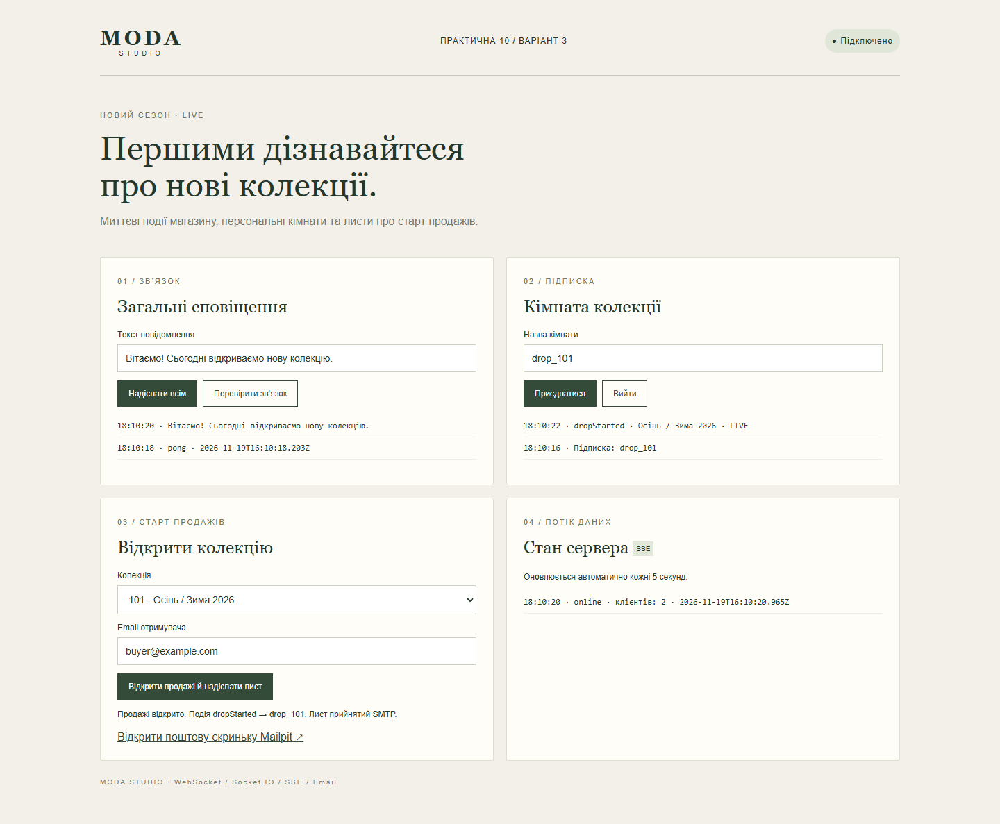
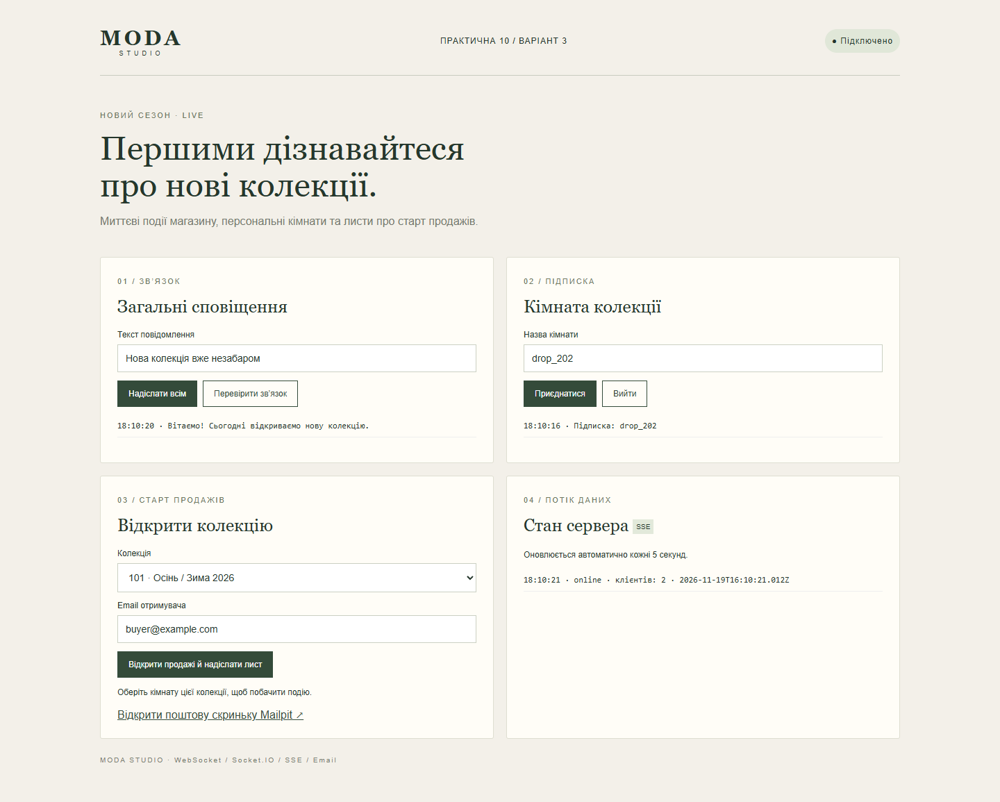
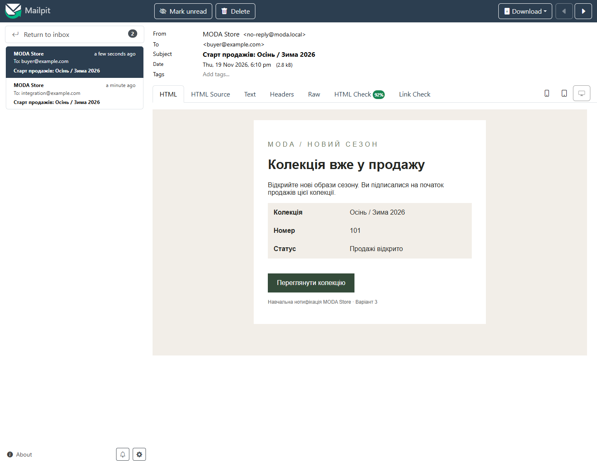

# Практична робота №10 — комунікація у реальному часі

**№23 у журналі → варіант 3: одяг та взуття.** Кімната `drop_<collectionId>`, подія `dropStarted`, лист про початок продажів сезонної колекції.

Окремий самодостатній NestJS-проєкт для завдання №10. Продовжує предметну область роботи №9; попередній репозиторій і його базу не змінює. Для відтворюваної демонстрації є колекції 101 та 202. Стани колекцій зберігаються в пам’яті, після перезапуску повертаються до DRAFT. Це цільовий модуль сповіщень, а не копія всього каталогу №9.

## Запуск

Потрібні Node.js 22+, npm. Mailpit можна запустити через Docker Compose:

```powershell
npm ci
docker compose up -d
npm run build
npm start
```

Відкрити [клієнт](http://localhost:3010/client.html) і [Mailpit](http://localhost:8025). Для повторного запуску застосунку можна використати `Start.cmd` (Mailpit запускається окремо). Параметри наведено в `.env.example`; за потреби скопіювати його в `.env`.

Без Docker: завантажити офіційний [Mailpit v1.34.0](https://github.com/axllent/mailpit/releases/tag/v1.34.0), розпакувати та виконати в окремому терміналі:

```powershell
.\mailpit.exe --listen 127.0.0.1:8025 --smtp 127.0.0.1:1025
```

Mailpit перехоплює листи локально, не надсилає їх на справжню пошту. Саме цей спосіб перевірено на Windows; Docker на машині перевірки відсутній, запуск Compose не перевірявся.

## Демонстрація трьох рівнів

1. Відкрити клієнт у двох вкладках. Натиснути «Перевірити зв’язок»: з’явиться `pong` з часом. «Надіслати всім» показує `globalAlert` в обох вкладках. Підключення та відключення логуються сервером із socket.id.
2. У першій вкладці приєднатися до `drop_101`, у другій — до `drop_202`. Доступні також вихід із кімнати та повторна підписка після перепідключення. Потік SSE показує час і кількість клієнтів кожні 5 секунд.
3. Для колекції 101 вказати email і натиснути «Відкрити продажі й надіслати лист». Перша вкладка отримає `dropStarted`, друга не отримає цю подію. У Mailpit з’явиться адаптивний HTML-лист з назвою колекції, статусом і кнопкою переходу.

Повторний старт колекції повертає 409. Для нового показу перезапустити сервер або скористатися колекцією 202. Якщо SMTP недоступний, повертається 502, стан залишається DRAFT. SMTP приймає лист перед зміною стану та WebSocket-подією; це послідовна навчальна реалізація, без гарантії атомарності між незалежними транспортами.

## API та структура

| Метод / подія | Призначення |
|---|---|
| `GET /collections` | Стани демонстраційних колекцій |
| `POST /collections/:id/start` | `{ "customerEmail": "buyer@example.com" }` → лист і `dropStarted` |
| `GET /notifications/events/stream` | SSE через `interval(5000)` та `map()` |
| `ping` → `pong` | Перевірка з’єднання |
| `broadcastNotification` → `globalAlert` | Текст до 500 символів усім клієнтам |
| `joinRoom`, `leaveRoom` | Рядок `drop_101` → `joined`, `left` |

`NotificationsModule` містить `EventsGateway`, `NotificationsController`, `CollectionsService` та `MailService`. На HTTP працює глобальний ValidationPipe; дані кімнат і повідомлень перевіряються в шлюзі. CORS шлюзу дозволяє всі джерела відповідно до завдання. Демо-маршрути відкриті, сервер призначений для локального показу. HTML листів екранує динамічний текст.

Готові запити: [requests.http](requests.http). Пояснення для захисту: [answers/README.md](answers/README.md).

## Перевірка та скриншоти

Із запущеним Mailpit: `npm test`. Інтеграційний тест сам запускає окремий сервер на 3012, підключає два сокети й завершує його після перевірки. Пройдено 3 тести, включно з багатокроковим сценарієм: ping/pong, broadcast, join/leave, ізоляція кімнат, SMTP, SSE та HTTP 400/404/409. Окремо перевірено помилку SMTP без зміни стану й екранування HTML. Деталі: [журнал тестів](evidence/tests.txt), [перевірки браузера](evidence/browser-checks.json).

Перша вкладка: подія колекції, підтвердження SMTP та SSE.



Друга вкладка: загальне повідомлення отримане, подія іншої кімнати відсутня.



Фактично отриманий лист у локальному Mailpit.



Реалізація орієнтується на офіційну документацію [NestJS Gateways](https://docs.nestjs.com/websockets/gateways) та [SSE](https://docs.nestjs.com/techniques/server-sent-events).
